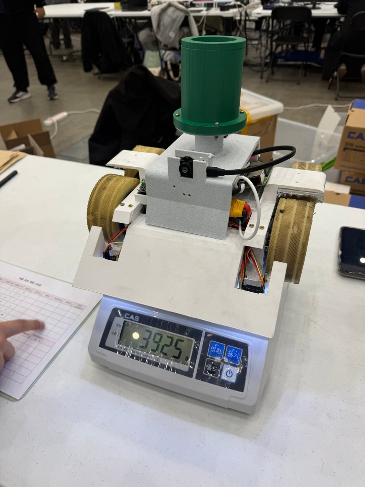
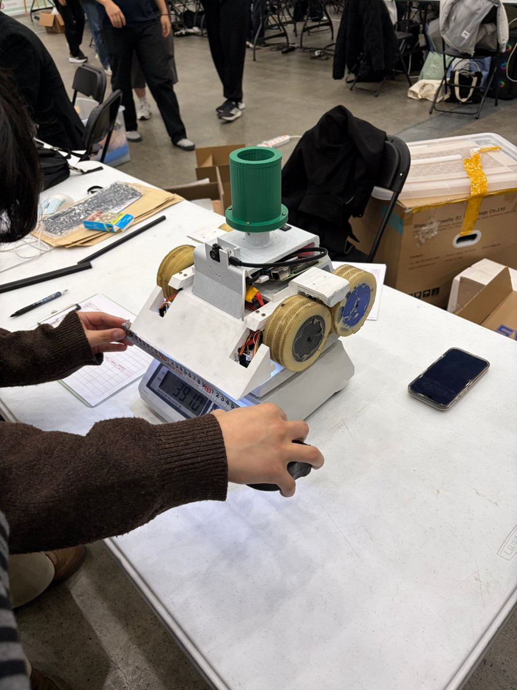
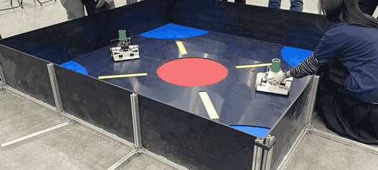
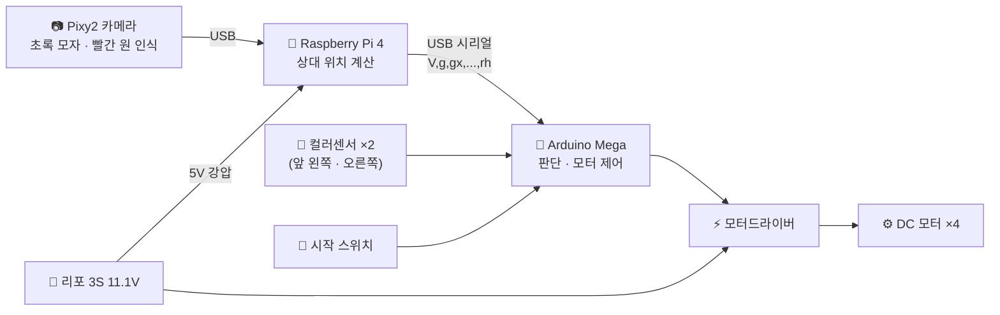
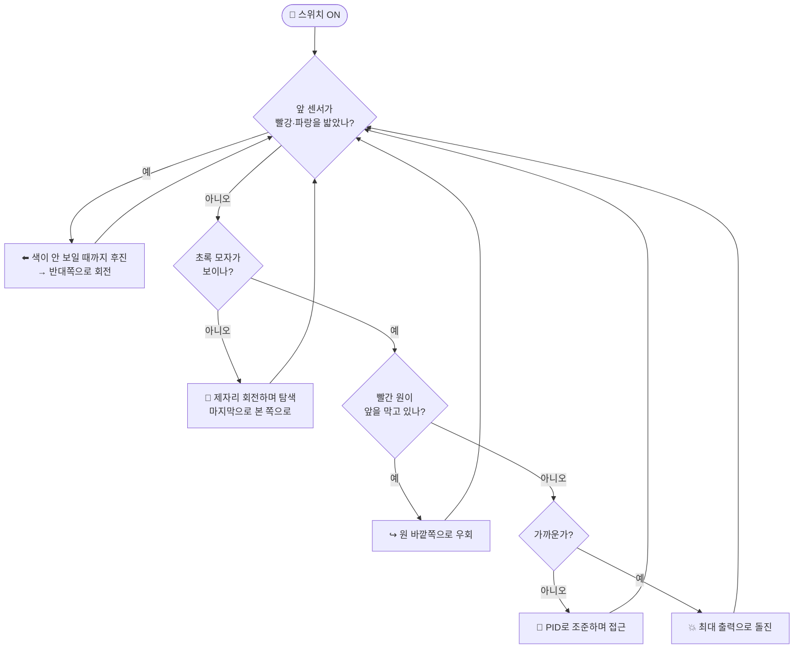

# 🤖 IRC 2026 지능형 씨름로봇

**국제로봇콘테스트(IRC) 2026 · 지능형 씨름로봇 종목 출전작**

설계부터 조립·배선·제어 코드까지 직접 만든 자율 씨름로봇

 

### 🎥 경기 장면

흰색 몸체 + 노란 바퀴가 우리 로봇

### 📄 [대회 회고 읽기 — 경기 영상 분석 · 문제 원인 · 개선 계획](docs/retrospective.md)

---

## 📌 한눈에 보기

| | |
|---|---|
| **대회** | 국제로봇콘테스트(IRC) 지능형 씨름로봇 · 2026.11.13 |
| **제작 기간** | 2026.07 ~ 11 (약 5개월) |
| **역할** | 기구 설계(SolidWorks) · 3D 프린팅 · 조립 · 배선 · 제어 코드 |
| **무게** | 약 3.9 kg |
| **핵심 기능** | 카메라로 상대 찾기 → 중앙 원 피해서 접근 → 돌진 / 바닥 색 감지해서 경기장 밖으로 안 나가기 |

---

## 🔧 시스템 구성

| 부분 | 사용 부품 |
|---|---|
| 🧠 상위 제어 | Raspberry Pi 4 (32비트 Raspberry Pi OS) |
| 🧠 하위 제어 | Arduino Mega 2560 |
| 👁️ 비전 | Pixy2 — 시그니처 1 = 상대 초록 모자, 시그니처 2 = 중앙 빨간 원 |
| 🎨 바닥 센서 | 컬러센서 2개 (앞 왼쪽 FL · 앞 오른쪽 FR) |
| ⚙️ 구동 | DC 모터 4개 (4륜), 바퀴 지름 100 mm · 폭 40 mm |
| 🔋 전원 | 리포 3S 11.1V 3500mAh → 모터 / 5V 5A 강압모듈 → 파이 |
| 📐 기구 | SolidWorks 직접 설계 + 3D 프린팅, 로봇 폭 29 cm |

---

## 🧭 동작 전략

> 바닥 회피가 항상 1순위 → 그다음 탐색 · 우회 · 추적 · 돌진

---

## 📁 폴더 구조

| 폴더 | 내용 |
|---|---|
| 📂 [`robot_arduino/`](robot_arduino) | Arduino Mega 코드 — **4륜 버전** |
| 📂 [`robot_arduino_2wd/`](robot_arduino_2wd) | Arduino Mega 코드 — **대회 당일 2륜 버전** (드라이버 1개로 구동) |
| 📂 [`robot_pi/`](robot_pi) | Raspberry Pi 코드 — Pixy2 블록 읽어서 Mega로 전송 |
| 📂 [`cad/`](cad) | SolidWorks 원본 + 3D 프린팅용 STL (STL은 웹에서 3D로 볼 수 있어요) |
| 📂 [`docs/`](docs) | 사진, 경기 영상, [대회 회고](docs/retrospective.md) |

---

## 🐛 개발하면서 겪은 문제와 해결

<b>⚡ 하드웨어</b>

| 문제 | 해결 |
|---|---|
| 대회 당일 **모터드라이버 소손** | 남은 드라이버로 **2륜 구동**으로 바꿔 출전 → 다음엔 여유 큰 드라이버 + 퓨즈 + 예비품 |
| 충돌하면 **바퀴가 빠짐** | 에폭시로 임시 고정 → 다음엔 허브 + 볼트 체결 |
| 모터 신호선 **접촉불량** | 터미널 쉴드 · 하우징 케이블로 재배선 |

<b>💻 소프트웨어 · 연결</b>

| 문제 | 해결 |
|---|---|
| 64비트 OS에서 **Pixy2 값이 깨짐** | 32비트 Raspberry Pi OS로 재설치 → 인식 성공 |
| 카메라를 **구형 Pixy로 잘못 설치** | 펌웨어 확인 후 Pixy2용으로 재설치 |
| 파이가 **핫스팟에 안 뜸** | 랜선으로 SSH 접속해서 복구 |

<b>🏁 경기에서 (영상 분석)</b>

| 문제 | 원인 (추정) | 다음 개선 |
|---|---|---|
| 경기 중 **약 17초 정지** | 대각선 2륜이라 제자리 회전 힘 부족 | 멈춤 감지 코드, 2륜·4륜별 출력 분리 |
| 상대와 **옆으로 붙음** | 2륜이라 회전 중심이 틀어짐 | 조준 PID 다시 맞추기 |
| 컬러센서 **현장 보정 못 함** | 코드·테스트 기간 약 2주 | 버튼 하나로 현장 보정 모드 |

👉 자세한 내용은 **[대회 회고](docs/retrospective.md)**

---

## 🚀 다음 버전 계획

- [ ] ⚡ 여유 큰 모터드라이버 + 퓨즈 + 예비품
- [ ] 🔩 바퀴 허브 + 볼트 체결, 앞쪽 낮은 쐐기판
- [ ] 💻 멈춤 감지 코드, 컬러센서 현장 보정 모드
- [ ] 🧹 커넥터 · PCB로 배선 정리
- [ ] 👁️ Pixy2 대신 OpenCV 영상분석 시도
- [ ] 📆 조립하면서 코드도 같이 시작, 대회 2~3주 전 완성
