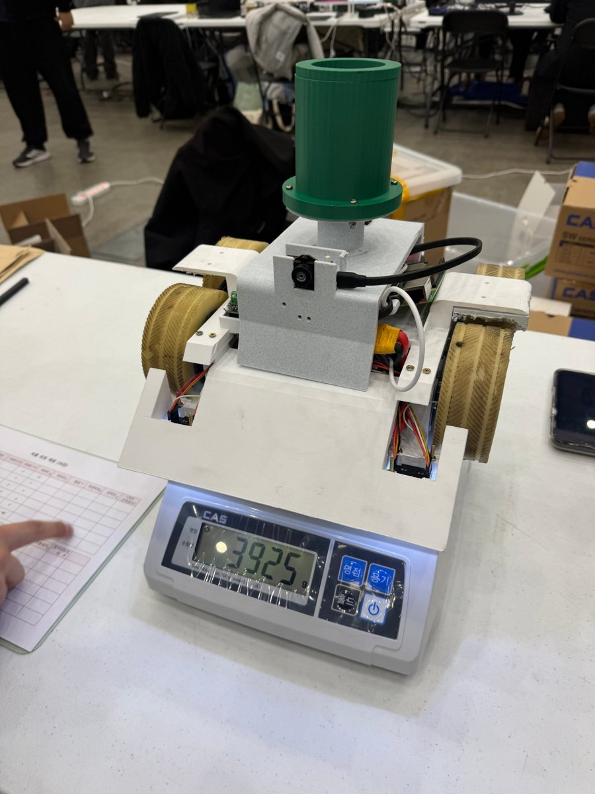
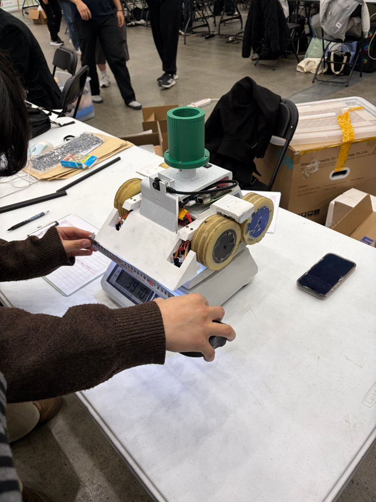
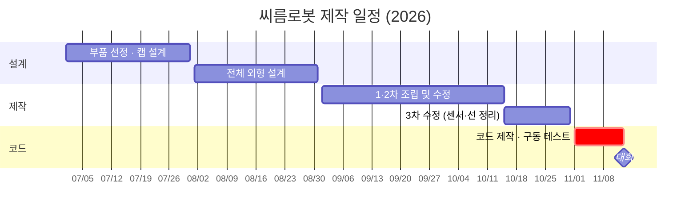
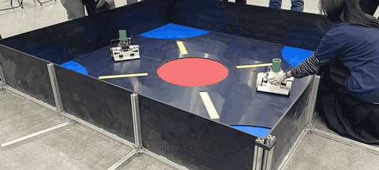
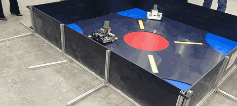

# 🤖 IRC 2026 씨름로봇 — 대회 회고

> [!NOTE]
> **한 줄 요약**
> 5개월 동안 설계·조립을 마쳤지만, 대회 당일 **모터드라이버가 타서 2륜으로 출전**했다.
> 그 때문에 회전·조준·미는 힘이 약해졌고, **코드 테스트 기간(약 2주)이 짧아** 현장 보정도 못 했다.

  
  

---

## 📌 한눈에 보기

| 항목 | 내용 |
|---|---|
| 대회 | 국제로봇콘테스트(IRC) 지능형 씨름로봇 · 2026.11.13 |
| 준비 기간 | 2026.07 ~ 11 (약 5개월) |
| 구성 | 라즈베리 파이 4 + Pixy2 카메라 / Arduino Mega / 컬러센서 2개 / DC 모터 4개 |
| 무게 | 약 **3.9 kg** (계체 3,910 ~ 3,925 g) |
| 대회 당일 | 오른쪽 모터드라이버 소손 → **대각선 2륜 구동**으로 출전 |
| 가장 큰 문제 | 2라운드에서 **약 17초 정지**, 상대를 **정면으로 못 잡음** |
| 다음 목표 | 드라이버·바퀴 체결 보강 → 멈춤 방지 코드 → 대회 2~3주 전 완성 |

---

## 1. 📅 일정

| 기간 | 한 일 |
|---|---|
| **7월** | 부품 선정, 부품에 맞는 **캡(모자) 설계** |
| **8월** | 부품에 맞춰 **전체 외형 설계** (SolidWorks) |
| **9~10월** | **1·2차 조립** 및 수정 |
| **10월 중순~** | **3차 수정** — 컬러센서 배치, 선 정리 |
| **11월** | **코드 제작 + 실제 구동** → 11/13 대회 |

> [!WARNING]
> 설계·조립에 4개월, **코드와 구동 테스트는 약 2주**. 그 2주도 연결 문제 해결에 많이 쓰였다.

<b>세부 진행 기록 펼치기 (10월 말 ~ 대회)</b>

| 날짜 | 한 일 |
|---|---|
| 10월 | 배선도 REV A로 배선 (엔코더 없이) / 파이 = 카메라, Mega = 센서·모터로 역할 분리 |
| 10/30 | 파이 설치, Pixy·Mega 연결, 시작 스위치, 모터 4개 회전 확인 |
| 11/03~05 | Pixy2를 구형으로 잘못 설치한 것 수정 / 64비트 OS 문제 → 32비트로 재설치해서 인식 성공 / 기구 크기 때문에 Pi 4 유지 |
| 11/05 | 터미널 블록 쉴드로 배선 재작업, 컬러센서 좌·우 분리 |
| 11/09 | 컬러센서를 앞 2개로 줄이고 배선도 REV B로 재배선 |
| 11/10 | 회피 방식 결정: 색이 안 보일 때까지 후진 → 회전 |
| 11/11~12 | 파이 핫스팟 연결 문제 → 랜선으로 복구 / 파이 교체 / 모터 좌·우 반대 발견 |
| 11/13 | 바퀴 빠짐 → 에폭시 고정 / **오른쪽 드라이버 소손 → 2륜으로 출전** |

---

## 2. 🎥 경기 영상 분석

> 흰색 몸체 + 노란 바퀴 = **우리 로봇** · 경기장: 가운데 빨간 원, 네 모서리 파란 구역

### 1라운드

- **8초** — 중앙에서 상대와 첫 접촉
- **13초** — 다시 붙었지만 **정면이 아니라 옆으로 나란히** 붙음
- **15~19초** — 우리 로봇이 벽·모서리 쪽으로 이동

### 2라운드

- **24~26초** — 중앙에서 접촉 후 떨어짐
- **26~43초** — 🚨 **우리 로봇이 오른쪽 뒤 파란 구역 근처에서 약 17초 동안 거의 안 움직임**
- 그동안 상대는 중앙 주변을 돌아다님

---

## 3. 🔍 문제 TOP 5

> [!TIP]
> 🟡 = 영상·코드로 본 **추정**. 다음 테스트 때 `STATE_DEBUG` 로그로 확인하기.

### ① 모터드라이버 소손 → 2륜 출전 `근본 원인`
- **무슨 일:** 대회 당일 오른쪽 드라이버가 탐. 왼쪽 드라이버 하나에 왼쪽 앞 + 오른쪽 뒤 모터를 연결
- **원인:** 드라이버 전류 여유 부족 🟡 · 퓨즈 없음 · 예비 드라이버 없음
- **영향:** 아래 ②③④가 다 여기서 시작됨

### ② 2라운드에서 17초 정지
- **근거:** 영상 26~43초
- **원인 🟡:** 대각선 2륜이라 **안 도는 바퀴 두 개가 끌림** → 탐색 회전 출력(100)·조준 출력(110)으로는 제자리 회전이 안 됐을 가능성
  - 코드 주석에도 `안 돌면 120`이라고 적어 둠
  - 또는 파란 구역에서 파랑 판정이 계속 나서 **회피 동작 반복**했을 가능성 (→ ⑤)

### ③ 상대를 정면으로 못 잡음
- **근거:** 1라운드 13초, 옆으로 나란히 붙음
- **원인 🟡:** 앞바퀴 하나 + 뒷바퀴 하나로 구동 → **회전 중심이 로봇 가운데가 아님** → 조준이 틀어짐. PID 값은 4륜 기준

### ④ 밀어내는 힘 부족
- **원인:** 구동 바퀴가 2개뿐 → 미는 힘이 약 절반
- **참고:** 상대 로봇 앞에는 **바닥에 붙은 낮은 판(쐐기)** 이 보였음

### ⑤ 준비 시간 부족 → 현장 보정 못 함
- **근거:** 코드·구동 테스트 약 2주 / 컬러센서 파랑 기준이 임시값 (`BLUE_RATIO 0.50`, 주석: "경기장 보정 때 다시 맞추기")
- **원인:** 하드웨어를 다 만든 뒤에 코드를 시작함 + 파이 와이파이·카메라 문제로 시간 소모

<b>그 밖의 문제</b>

- 충돌하면 바퀴가 빠짐 → 원형 구멍 끼움 방식이라 에폭시로 임시 고정
- 점퍼선 접촉불량 → 터미널 쉴드·하우징 케이블로 재배선
- 파이 64비트 OS에서 Pixy2 값이 깨짐 → 32비트로 해결

---

## 4. 🛠️ 개선 계획

| 순서 | 분야 | 할 일 |
|:---:|---|---|
| **1** | ⚡ 전원·구동 | 모터 정지전류 측정 → **여유 큰 드라이버로 교체**, **퓨즈** 추가, **예비 드라이버** 준비 |
| **2** | 🔩 기구 | 바퀴를 **허브 + 볼트 체결**로 재설계 / 앞쪽 **낮은 쐐기판** 검토 / 옆면 배선 구멍 정리 |
| **3** | 💻 코드 | **멈춤 감지**: 같은 상태가 1초 이상 이어지면 출력 올리기·후진·반대 회전 / 2륜·4륜별 **회전 출력·PID 따로** / 버튼 하나로 **컬러센서 현장 보정** |
| **4** | 📆 일정 | **조립하는 동안 코드도 같이** 시작 / **대회 2~3주 전 완성** → 실전 테스트 + 영상 분석 |
| **5** | 🚀 도전 | Pixy2 대신 **OpenCV 영상분석**으로 상대 인식 |

---

## 5. 💡 배운 점

1. **예비 부품이 없으면 하나만 고장 나도 전략 전체가 무너진다.** 드라이버 하나가 2륜 → 회전·조준·힘 문제로 이어졌다.
2. **코드와 테스트 시간을 따로 확보해야 한다.** 하드웨어가 완성돼도 실제로 움직여 봐야 문제가 보인다.
3. **경기 영상을 찍어 두면 문제가 보인다.** 이번 분석으로 "멈춤"과 "옆으로 붙음"을 찾았다.

---

<b>✅ 다음 대회 전날 체크리스트</b>

- [ ] 모터 4개 정방향·역방향 확인
- [ ] 가장 낮은 출력에서도 **제자리 회전이 되는지** 확인
- [ ] 컬러센서 경기장에서 보정 (검정·빨강·파랑)
- [ ] 카메라 초록 모자 인식 확인
- [ ] 예비 드라이버, 퓨즈, 배터리 2개 이상 충전
- [ ] 계체: 무게·크기 규정 확인
- [ ] 노트북에 최신 코드 (GitHub에서 받기)

